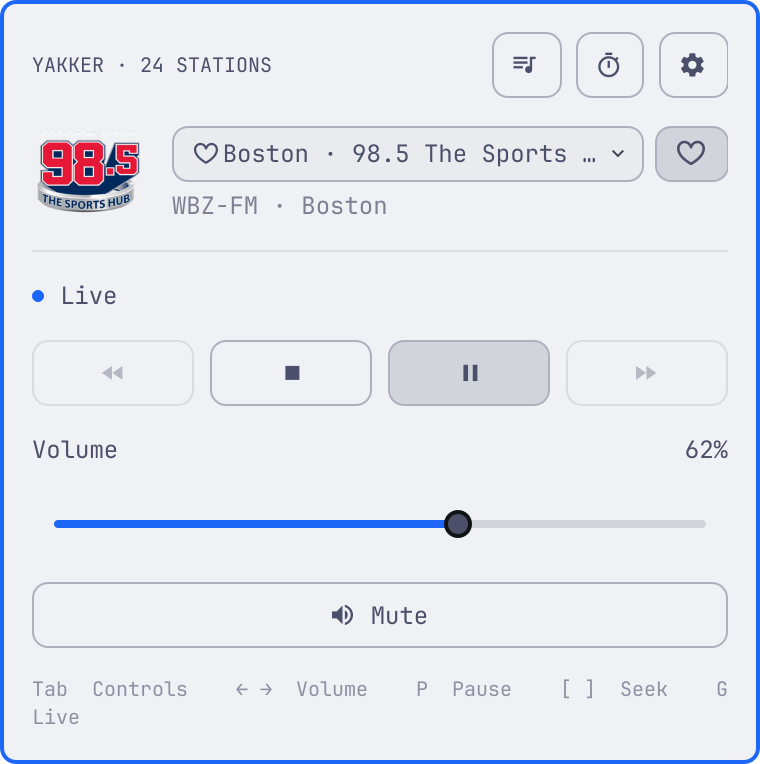
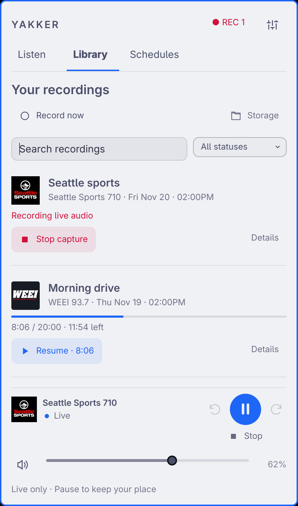
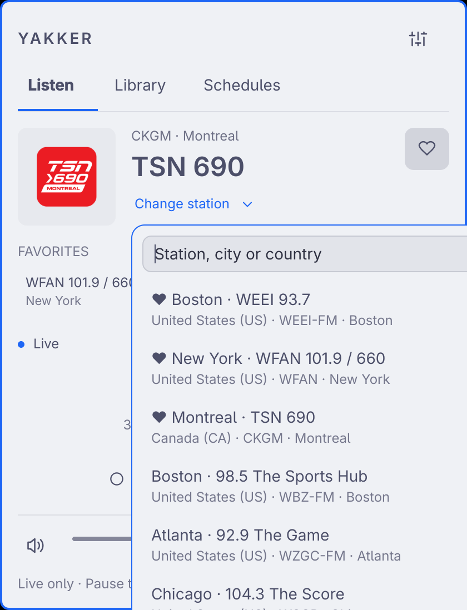
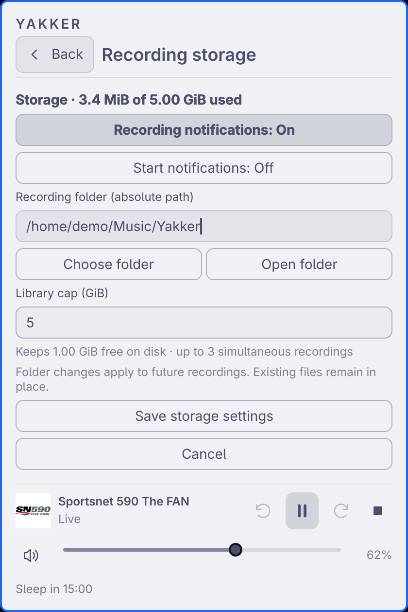

# Yakker

A lightweight sports-radio player for your desktop, with **pause, rewind, and scheduled recordings**.

Native Qt/QML internet radio for the Quattro bar, with a compiled Go controller.
Twenty-four stations across the US, Canada, UK and Ireland, streamed through headless mpv.
Choose a station on first launch; Yakker remembers your last choice. A fresh
install has no preselected station. If a saved station disappears, choose another.
No browser required. The widget starts playback only when you press Play.

**Pause live radio, rewind a segment, and jump back to live.** Take a call, then
resume where you left off while audio keeps arriving. Choose **5, 15, or 30
minutes of history** in Settings; use the timeline, skip back or forward
30 seconds, or select **Go live** to catch up. **Live only** remains the default,
and buffered audio stays in RAM without creating recording files.

**Save a show for later.** Schedule recordings by weekday and timezone, keep
compact Opus files in `~/Music/Yakker`, and play them inside Yakker. Choose your
recording folder and storage cap. Favorite stations stay at the top of search,
and you can add your own stream URLs.

Plugin ID: `io.github.joega.yakker`. Code is MIT licensed. Unaffiliated with the broadcaster.
The bundled station logos belong to their respective owners; see [artwork attribution](assets/README.md).

[Install](#install-locally) · [DVR controls](#pause-and-rewind) · [Recordings](#scheduled-recordings) · [Stations](#stations) · [Terminal player](#terminal-player) · [Settings](#settings-and-stations)

| Live radio | Pause and rewind | Recording library |
| :---: | :---: | :---: |
| [](docs/yakker-popup.png) | [](docs/yakker-dvr.png) | [](docs/yakker-recordings.png) |

| Favorites and search | Weekly schedules | Settings and custom stations |
| :---: | :---: | :---: |
| [](docs/yakker-stations.png) | [](docs/yakker-schedule.png) | [](docs/yakker-settings.png) |

Yakker follows your active Omarchy theme. Screenshots use Catppuccin Latte.

_Select any screenshot to enlarge it. Screens show the current native UI with
illustrative playback and recording data; see [how to refresh them](docs/screenshots.md)._

## Stations

| Country | City | Station | CLI station ID |
| --- | --- | --- | --- |
| US | Atlanta | 92.9 The Game | `wzgc-fm` |
| US | Boston | 98.5 The Sports Hub | `wbz-fm` |
| US | Boston | WEEI 93.7 | `weei-fm` |
| US | Chicago | 104.3 The Score | `wscr` |
| US | Cleveland | 92.3 The Fan | `wkrk-fm` |
| US | Columbus | 97.1 The Fan | `wbns-fm` |
| US | Dallas–Fort Worth | 105.3 The Fan | `krld-fm` |
| US | Denver | 104.3 The Fan | `kkfn-fm` |
| US | Detroit | 97.1 The Ticket | `wxyt-fm` |
| US | Los Angeles | AM 570 LA Sports | `klac` |
| US | Minneapolis | KFAN 100.3 | `kfan` |
| US | New York | ESPN New York 880 | `espn-new-york` |
| US | New York | WFAN 101.9 / 660 | `wfan` |
| US | Philadelphia | SportsRadio 94WIP | `wip-fm` |
| US | Pittsburgh | 93.7 The Fan | `kdka-fm` |
| US | San Diego | 97.3 The Fan | `kwfn-fm` |
| US | Seattle | Seattle Sports 710 | `kiro-am` |
| Canada | Montreal | TSN 690 | `tsn-690` |
| Canada | Toronto | Sportsnet 590 The FAN | `sportsnet-590` |
| Canada | Toronto | TSN 1050 | `tsn-1050` |
| UK | London | BBC Radio 5 Live | `bbc-radio-5-live` |
| UK | London | talkSPORT | `talksport` |
| UK | London | talkSPORT 2 | `talksport-2` |
| Ireland | Dublin | Off The Ball | `off-the-ball` |

## Requirements

- Omarchy / Quattro with `qs.Ui.SearchableDropdown` and the documented bar-widget API (tested on Omarchy 4.5.0).
- Quickshell 0.3.2, Qt 6.12, and mpv 0.41 (tested versions).
- Go 1.26+ and Make to build from source. Go is only needed at build time.
- Linux with working audio. The bar widget also needs a desktop session with a private `XDG_RUNTIME_DIR`.
- Optional: the distribution's `mpv-mpris` package for media keys.
- Scheduled recordings need `ffmpeg` with the `libopus` encoder and `ffprobe`.
  Listening and playing retained recordings use mpv.

These are tested versions; older shells must provide the same native UI components.
The controller uses only Go’s standard library and builds without cgo. The
terminal tool includes Bubble Tea and Lip Gloss, with versions and checksums
pinned in `go.mod` and `go.sum`; the first build downloads those Go modules.
Both executables are standalone Linux binaries. The terminal modes need mpv and
audio; they can run without Omarchy or Qt.

## Install locally

For a compiled archive, extract it and run `./yakker tui` or
`./yakker install` from its `yakker/` directory; no build is needed.

For a source checkout:

```sh
git clone https://github.com/joega/yakker.git
cd yakker
make build
./yakker install
```

The build produces `yakker-controller` (the runtime controller) and `yakker`
(standalone playback and local installation). Run the installer from this checkout. It validates and copies the compiled controller, QML, and assets to
`~/.config/omarchy/plugins/io.github.joega.yakker`, rescans the existing shell,
and enables a new widget in its default right section. Existing widgets remain
in place. It uses Omarchy's documented drop-in workflow; `omarchy dev link` is
for developing the shell itself. No second Quickshell instance is launched.
Run the installer again after editing this checkout. For helper/controller code
updates, stop playback and run `omarchy restart shell` after reinstalling so the
shared singleton and helper process load the new code. It refuses to overwrite
unmanaged installations or edits made directly in the installed files. Replaced
managed installations are retained under `~/.config/omarchy/plugin-backups/`.

The source checkout must be built before installation; `omarchy plugin add`
clones source without compiling the controller. Update a local installation by
rebuilding and rerunning the installer from the same checkout path. The installer
keeps an ownership marker and refuses to overwrite files edited in the installed
copy. Existing bar entries and their saved preferences are retained.

`make build` produces stripped binaries. To create compiled Linux archives with
checksums and dependency license notices:

```sh
make release TARGET_ARCH=amd64
make release TARGET_ARCH=arm64
```

Archives are written to `dist/`. Each contains a `yakker/` directory with both
executables, the station catalogue, QML, local artwork, and this guide. Keep these
files together; the executables locate the catalogue beside themselves. Release
packaging builds locally and does not publish or install anything.

## Listen

Click the radio icon in the bar, select a station, then press the **Play** icon.
Your last chosen station is restored on later launches. If it is no longer in
the catalogue, choose another station; Yakker never substitutes a broadcaster.
The transport row contains **Rewind · Stop · Play/Pause · Forward**. Rewind and
forward skip 30 seconds and dim when unavailable. **Play/Pause** pauses or resumes
an active player; **Stop** releases it. Playing a stopped radio starts a fresh
live stream. Closing the popup leaves audio playing.
Right-click the bar icon to open the station list directly.
The popup includes a searchable station selector, volume, mute, connection status, and Retry after errors.
Search by station, city or country—for example, `690`, `Seattle`, `UK` or `Ireland`.
Changing stations while playing makes a fresh live connection; while stopped it
selects the next station without starting playback. The last station, volume,
mute setting and listening buffer length are remembered across shell restarts.
The bar shows a neutral radio icon until playback is live, then switches to the
playing station's bundled logo. Stop restores the neutral icon; connecting,
reconnecting and errors also use it. The popup keeps the selected station's logo.
The bar status dot uses accent
color while playing and the urgent theme color for errors. Hover it for station and status.

Keyboard inside the popup: Tab or Up/Down moves between controls, including
Settings and the DVR controls when available;
Space/Enter activates the selection. Inside the station selector, type to search,
Down browses the matches, Enter selects, and Escape cancels and clears the search. Left/Right adjusts volume by 5%; M toggles
mute; R retries a stopped stream; Escape dismisses the popup. Right-clicking the
volume slider also toggles mute. Wheel over the slider adjusts volume.

For diagnostics or scripted controls:

```sh
omarchy-shell shell summon io.github.joega.yakker '{}'
omarchy-shell io.github.joega.yakker play
omarchy-shell io.github.joega.yakker stop
omarchy-shell io.github.joega.yakker setVolume 65
omarchy-shell io.github.joega.yakker toggleMute
omarchy-shell io.github.joega.yakker setStation wfan
omarchy-shell io.github.joega.yakker chooseStation
omarchy-shell io.github.joega.yakker status
omarchy-shell shell hide io.github.joega.yakker
```

## Pause and rewind

The optional DVR-style buffer lets you pause a live station and listen from that
point later. Open **Settings** in the radio popup and choose a **Listening buffer**:

- **Live only** (default): no replay history is exposed until you pause.
- **5 minutes**, **15 minutes**, or **30 minutes**: enable pause and rewind for the selected station.

Press **Pause** or **P** during Live only playback to start a temporary **15-minute**
RAM buffer without reconnecting the stream. **Resume** continues from the paused
position, and the timeline, **Rewind / Forward**, and **Go live** become available.
The saved Live only setting stays unchanged. This temporary buffer ends when you
Stop, change stations, explicitly change the buffer setting, or close the player.
A stream reconnection retains temporary mode but clears the old connection's
audio, so the original paused position is lost.

With a configured buffer, use the same **Pause / Resume**, timeline,
**Rewind / Forward**, and **Go live** controls. Audio continues arriving while paused. History begins when buffering
is enabled; programmes from before that connection are unavailable. Changing
stations or buffer length, pressing Stop, or closing the player clears history.
The widget remembers the selected buffer length without starting playback at login.

Buffered audio stays in RAM; no audio files are recorded. The forward and backward
packet caches together are capped at 32 MiB for 5 minutes, 64 MiB for 15 minutes,
and 128 MiB for 30 minutes, in addition to normal player/decoder memory.
Temporary pause buffering uses the 15-minute / 64 MiB cap. To make immediate
pause possible without reconnecting, Live only also prepares this bounded
packet cache at startup. RAM use can therefore grow before you pause; earlier
audio is not exposed as replay history. This is a cap, not a fixed allocation. Actual use
grows with received audio. The byte cap can shorten the available window on
high-bitrate streams. When a paused position expires, playback moves to the oldest
available audio and remains paused. Reconnecting after a stream failure also clears
that connection's buffer. “Live” is relative to the newest audio received from the
station, which may already have a broadcaster delay.

Popup shortcuts: **P** pauses/resumes, **[ / ]** skip 30 seconds, and **G** goes live.
The plain CLI accepts `pause`, `play` (resume), `back 30`, `forward 30`, `live`, and
`buffer 0`, `buffer 5`, `buffer 15`, or `buffer 30`. Terminal modes use `--buffer`:

```sh
./yakker tui --buffer 30
./yakker listen --buffer 15
```

In the terminal UI, **P** pauses/resumes, **[ / ]** skip 30 seconds, **G** goes live,
and Space retains Play / Stop. Buffer preferences in terminal sessions are
independent of the desktop widget.

## Scheduled recordings

Open the **Recordings icon → New schedule**, choose a bundled or custom station, select
weekdays, enter start/end times in 24-hour format, and choose the timezone. Use
**Preview next time** to check the resolved occurrence before saving. For example,
WBZ-FM can record Fridays from `14:00` to `14:20` in `America/New_York`. A time
before the start ends the next day; schedules can last up to 12 hours. Daylight
saving follows the saved timezone. Schedules start empty; create and enable the
ones you want.

| Saved-show playback | Recording storage |
| :---: | :---: |
| [](docs/yakker-recording-player.png) | [](docs/yakker-storage.png) |

Up to **three recordings** can run at once, including while you listen to another
station. Closing the popup, stopping foreground audio, changing stations, or
playing a saved recording leaves those captures running. The bar dot turns red
while capturing; the Recordings button highlights and its tooltip shows the active count. The machine must be awake
with the plugin loaded in the bar. Disabling/removing the last widget, restarting
the shell, or shutting down the helper interrupts captures. Recoverable output is
retained as partial; when the plugin returns during the scheduled interval it can
capture a linked remainder. Unexpected stream failures can retry twice within
the remaining interval, retaining separate segments. There is no wake timer or separate recording service.

Recordings use **mono Opus at 24 kbit/s VBR** in `.opus` files: roughly **3.6 MB
per 20 minutes** or **10.8 MB per hour**, plus container overhead, with sizes
varying by content. The bitrate is an internal encoder parameter; raising it later
affects future captures. The library shows complete, partial, missed, error and
missing-file states with their reasons. **Play** opens a retained file in the
foreground player, with pause/resume, a duration-based seek bar and **Return to
live**. Missing files become available again when their retained folder returns.
Audio quality and exact broadcast boundaries depend on the source; connection
startup, broadcaster buffering and network interruptions can affect the segment.

Dates use a consistent format such as **Fri Nov 20 2026 02:30PM**. Library dates
use local time; upcoming schedule times and previews use the schedule's timezone.

Open **Settings → Recording storage**, or the storage controls in Recordings, to
choose a folder and total library cap. Defaults:

- **Folder:** `~/Music/Yakker`, created when the first capture needs it.
- **Library cap:** 5 GiB, editable in Settings.
- **Free-space reserve:** 1 GiB on the destination disk.
- **Cleanup:** manual deletion; existing recordings are preserved when full.

A folder change applies to future recordings. Older files remain listed at their
saved locations and count toward the cap. An unavailable/unwritable destination
produces an explicit failure instead of switching folders. Lowering the cap below
current usage preserves files and blocks new captures until space is available.
Metadata, schedules and recording settings live separately in
`$XDG_DATA_HOME/yakker/recordings.json` (normally
`~/.local/share/yakker/recordings.json`), outside the replaceable plugin files.
Uninstalling the plugin preserves this data and the audio files.

Schedule edits and enable/disable/delete actions affect future occurrences; an
already running capture retains its original settings and has a separate **Stop
capture** action. Editing a station does not silently change a saved schedule's
source. Saving that schedule in the editor refreshes its source from the latest
available catalogue entry; a removed station's saved source is retained. Saved
recordings survive schedule deletion. Delete requires confirmation, and a capture
or file that is currently playing must be stopped before deletion.

Changes from another monitor or a background job can make an editor stale. Your
draft stays visible; **Refresh and keep this draft** lets you review and resubmit
it. The helper can restart with bounded retries after an interruption, restoring
schedules without automatically starting foreground listening. Terminal sessions
remain independent and do not start the desktop scheduler.

## Terminal player

Open the Bubble Tea player without changing the installed widget:

```sh
./yakker tui
```

Run `./yakker tui` to choose a station on first launch, then press Enter to play.
Later terminal sessions restore your last chosen station.
An explicit `--station` overrides that choice. Terminal selection is saved
separately from the desktop widget in `$XDG_CONFIG_HOME/yakker/terminal.json`
(normally `~/.config/yakker/terminal.json`). Sessions using `--stations` or `--url`
keep their selections separate and do not change that saved choice.

The player shows the current station, actual playback/connection status, volume,
mute, and stream metadata when available. It uses a compact layout in smaller
terminals and adapts its colors to the terminal background and color support.

| Key | Action |
| --- | --- |
| Space | Play / Stop |
| `p` | Pause / Resume; starts a temporary buffer in Live only |
| `[` / `]` | Rewind / forward 30 seconds |
| `g` | Go live |
| Left / Right or `-` / `+` | Change volume by 5% |
| `m` | Toggle mute |
| Up / Down or `k` / `j` | Browse configured stations |
| Enter | Tune the highlighted station |
| `r` | Make a fresh connection |
| `?` | Show / hide help |
| `q`, Escape, or Ctrl+C | Quit and clean up playback |

Browsing leaves playback on the current station until Enter. The active station
is marked with a dot; the highlighted row is the station selected for tuning.
Play after Stop reconnects to the live stream. The interface returns the terminal
to its normal screen and waits for player cleanup when you quit.

The same `--url`, `--stations`, `--volume`, `--muted`, and `--list-stations`
arguments work with `tui`; use `./yakker tui --help` for details. It needs an
interactive terminal. The plain `listen` command below remains available for
line-oriented or piped input. Both modes keep the desktop audio environment and
widget settings intact and use their own temporary lock/socket directory.

## Standalone CLI

The built CLI runs independently of the installed Omarchy widget:

```sh
./yakker listen --station wbz-fm --volume 60
```

It starts the selected station and prints readable connection/playback status.
Without `--station`, `listen` uses your last terminal station. If none has been
chosen, or it was removed, use `--list-stations` and supply a station ID.
Volume defaults to 60%; `--muted` starts muted. Its private lock/socket directory
is created and removed automatically. Desktop audio environment variables,
widget settings, and the installed plugin are not changed.

Type a command and press Enter:

```text
volume 40
mute
unmute
stop
play
status
help
quit
```

`mute` toggles mute; `unmute` always unmutes. `play` after `stop` connects to a
fresh live stream. Ctrl+C or input EOF also exits and cleans up the player.
Invalid commands show a readable message without interrupting playback.

To discover station IDs, test an arbitrary stream, or use another station file:

```sh
./yakker listen --list-stations
./yakker listen --url 'https://example.com/live.aac' --volume 60
./yakker listen --stations /path/to/stations.json --station my-station
./yakker listen --help
```

The example URL is a placeholder; supply an actual HTTP(S) audio stream. A custom
URL uses a temporary station record and does not modify `stations.json`.
Arguments are parsed locally; the widget's JSON protocol stays internal.
This is a plain line-oriented CLI; each command requires Enter.

## Settings and stations

In Settings, use **Add custom station** to save a name and HTTP(S) audio stream URL; city, country, and website are optional. Select a saved custom station in the station picker to edit or delete it. Deleting the selected station stops playback and clears the selection so you can choose another. Editing its stream URL reconnects if it was playing. Yakker does not fetch or test a URL until you play it.

Custom stations are saved separately from the installed plugin in `$XDG_CONFIG_HOME/yakker/stations.json` (normally `~/.config/yakker/stations.json`). They persist through plugin upgrades and removal. The default terminal player and `--list-stations` include them; explicit `--stations` and `--url` sessions remain isolated. If the custom file cannot be read or is malformed, the widget keeps bundled stations available and shows an error; repair the file and restart Yakker before editing. The terminal player reports the error.

Use the heart beside the station picker to add or remove the selected station from favorites. Favorites appear first in the picker and in matching search results, including custom stations.

The selected station, favorites, volume, mute and listening buffer length are saved through Quattro's inline entry persistence in
`~/.config/omarchy/shell.json`. The widget entry also accepts:

```json
{
  "id": "io.github.joega.yakker",
  "volume": 65,
  "muted": false,
  "stationId": "",
  "favorites": [],
  "bufferMinutes": 0,
  "showName": false,
  "mprisPlugin": ""
}
```

Choose a station by ID from the [catalogue above](#stations).

For example: `./yakker tui --station tsn-690 --volume 60` or
`./yakker tui --station talksport --volume 60`.
The UK selection includes football talk on talkSPORT, broader live sport on
talkSPORT 2, and news/football/sport on BBC Radio 5 Live. Off The Ball adds Irish
football and sports discussion. The BBC entry uses its worldwide feed.
The standalone terminal modes keep their session independent of saved widget settings.

`showName` adds a compact “Radio” label on horizontal bars. `stations.json`
contains station ID, name, subtitle, HTTP(S) stream URL, optional city/country/website,
optional local `artwork` path, optional `artworkBackground` color for logo contrast,
and an optional fallback Nerd Font `icon`. Both the bar and terminal player read
this catalogue. After editing station data, rebuild/reinstall and restart the shell.
New artwork must also be included in the installer and release file lists; tests
check the bundled catalogue's coverage. The default stream is
`https://playerservices.streamtheworld.com/api/livestream-redirect/WBZFMAAC.aac`.
No network configuration fetch is needed.

## Media keys and metadata

Stock mpv does not provide MPRIS. To opt in with an existing, trusted
[mpv-mpris](https://github.com/hoyon/mpv-mpris) installation, set `mprisPlugin`
to its absolute file path (a common Arch path is `/etc/mpv/scripts/mpris.so`).
No plugin or global keybinding is installed automatically. All other mpv user
configuration and scripts are disabled for predictable playback.

MPRIS exists while the player is running and exposes the station title, state,
volume, and media controls. Pause retains buffered audio; in Live only mode it starts the same temporary
15-minute buffer as the widget and terminal controls. After Stop, use the radio widget to start again: no idle MPRIS player is
kept alive. Your desktop chooses which application's MPRIS session media keys
control. Native widget controls work with MPRIS disabled.

The helper observes stream metadata and shows an actual `icy-title` or `title`
when supplied. The verified WBZ response identifies the station and AAC stream;
a changing current-program title is not guaranteed. There is no scraped program
schedule, fabricated show name, remote artwork fetch, or periodic website request. The official station logo is bundled locally.

## Lifecycle and reliability

A shared QML singleton owns one compiled Go helper. The helper owns one foreground
mpv process and a JSON IPC socket under `$XDG_RUNTIME_DIR/io.github.joega.yakker/`.
A private runtime directory and exclusive lock prevent duplicate players, including
across monitors or overlapping shell reloads. Stop cancels retry work, terminates
mpv, waits for it, and removes the socket before another player can start.

Popup closing and bar visibility do not own playback. Recreating widgets has a
one-second grace period. With no widgets left (disable/remove), the helper shuts
down. EOF, SIGTERM, and Linux parent-death protection clean up the player if the
shell or helper exits. Recording workers have independent foreground controls
and are finalized/reaped on helper shutdown. Full shell restarts may stop
listening; press Play to reconnect.
Playback intent is never saved or automatically restored after login.

Failed connections and stalled streams time out and retry at 1, 2, 4, 8, and 16
seconds, then stop with Retry available. A minute of successful playback resets
the failure budget. Network buffering is reported as Connecting. State comes
from mpv events rather than an optimistic Play button. Live only starts playback as audio arrives and prepares a bounded in-memory
packet cache for immediate pause; end-to-end delay also depends on the
broadcaster, output device, and network.

## Disable and remove

```sh
omarchy plugin disable io.github.joega.yakker
omarchy plugin remove io.github.joega.yakker --yes
```

Disable removes the bar entry and shuts down radio within a few seconds. Remove
also deletes the installed copy. Capture finalization may take a few more seconds.
Recording files, schedules and this source checkout remain available.

## Troubleshooting

- Missing mpv: install your distribution's `mpv` package, then Retry.
- Unable to connect: check network access and the station stream; Retry after the
  bounded attempts finish. Regional restrictions or broadcaster outages can apply.
- Helper already owned: allow the old shell a moment to exit, then Retry. Do not
  delete the live owner's lock file; the lock is released by process exit.
- No sound with “Live”: check radio volume/mute, the system output and mixer.
  “Live” confirms player activity, not acoustic output from your speakers.
- Missing widget: run `omarchy plugin list --json`, then `omarchy plugin enable
  io.github.joega.yakker`. Inspect logs with `qs log -n -p "$OMARCHY_PATH/shell"
  --tail 100`.
- Recording encoder unavailable: install your distribution's FFmpeg package with
  libopus and ffprobe, then disable/re-enable the widget or restart the shell.
- Recording index unavailable: preserve and repair the reported metadata file;
  Yakker refuses to overwrite malformed data. Ordinary listening remains available.
- Source edits: rerun the local installer. Do not modify packaged Omarchy files.

## Build checks

```sh
make check
YAKKER_TEST_REAL_MPV=1 make check  # Also decode local test audio with mpv
```

Checks cover formatting, vet, module checksums, and race-enabled tests. The
recording checks include atomic storage/recovery, timezone/DST rules, cap limits,
revision fencing and child cleanup. The optional mpv checks use local HTTP
fixtures and null audio; they do not contact
broadcasters or change the installed widget. GitHub Actions runs these checks
and builds Linux amd64 and arm64 archives.

Optional native UI checks (installed Omarchy controls required):

```sh
python3 tools/test-recordings-ui.py
```

This uses isolated temporary settings/data and silent local audio. It verifies
keyboard navigation, scheduling, preview, stale drafts, file playback/seek and
helper recovery, and writes screenshots under `/tmp/yakker-recordings-ui-qa`.
Its test container substitutes for the actual layer-shell popup. Audible quality,
physical sleep/resume, and installed-shell focus/lifecycle behavior also need
manual checks on the target desktop.

## Privacy and licensing

Yakker has no analytics, account system, or background station discovery.
Playback connects to the selected broadcaster and its stream providers, which
receive the network request. Enabled recording schedules also connect to their
saved station sources while due and the plugin is running. Artwork and station configuration are bundled
locally. The widget saves station, volume, and mute preferences on your device;
standalone terminal sessions use temporary local state.

The code is MIT licensed; see [LICENSE](LICENSE). Station artwork and broadcaster
marks are owned by their respective owners and are excluded from the code
license; see [artwork attribution](assets/README.md). Compiled archives include
`THIRD_PARTY_NOTICES.txt` for their Go dependencies.

## Made something with Yakker?

If you build something with Yakker, please consider crediting
[Yakker](https://github.com/joega/yakker) by [@joega](https://github.com/joega)
in your README or credits. I'd love to see what you make—share a link in an issue!

This is an optional request; use of Yakker is governed by the MIT license above.
