# Yakker

A native sports-radio player with **pause, rewind, scheduled recordings, and a polished Focus interface**.

Native Qt/QML internet radio for the Quattro bar, with a compiled Go controller.
Twenty-four stations across the US, Canada, UK and Ireland, streamed through headless mpv.
Choose a station on first launch; Yakker remembers your last choice. A fresh
install has no preselected station. If a saved station disappears, choose another.
No browser required. The widget starts playback only when you press Play.

**Pause live radio, rewind a segment, and jump back to live.** Take a call, then
resume where you left off while audio keeps arriving. Choose **5, 15, or 30
minutes of history** in Settings; use the timeline, skip back or forward
30 seconds, or select **Go live** to catch up. **Live only** remains the default,
and buffered audio stays in RAM without creating recording files.

**Keep listening while you browse.** Favorite station presets, clear Pause and
Stop controls, and a persistent playback dock connect Listen, Library, Schedules,
and Settings. The compact bar shows playback state and any active recordings;
its tooltip gives the full status.

**Save a show for later.** Record now or schedule a show once or weekly, keep
compact Opus files in `~/Music/Yakker`, and resume them inside Yakker. Choose your recording folder
and storage cap. Favorite stations stay at the top of search,
and you can add your own stream URLs.

Plugin ID: `io.github.joega.yakker`. Code is MIT licensed. Unaffiliated with the broadcaster.
The bundled station logos belong to their respective owners; see [artwork attribution](assets/README.md).

[What’s new in 1.6](#whats-new-in-16) · [Install](#install-locally) · [DVR controls](#pause-and-rewind) · [Recordings](#scheduled-recordings) · [Stations](#stations) · [Terminal player](#terminal-player) · [Settings](#settings-and-stations)

| Live radio | Pause and rewind | Recording library |
| :---: | :---: | :---: |
| [](docs/yakker-popup.png) | [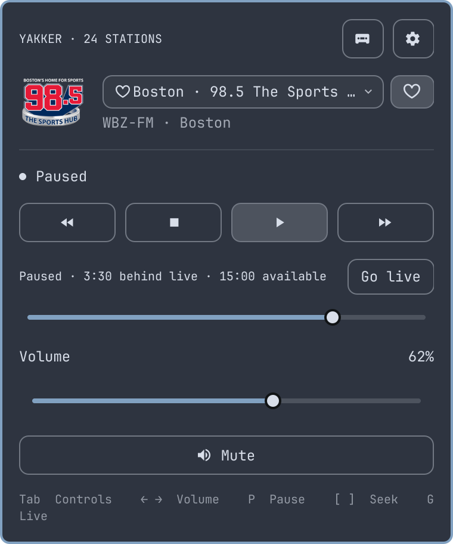](docs/yakker-dvr.png) | [](docs/yakker-recordings.png) |

| Station picker | Upcoming recordings | Listening settings |
| :---: | :---: | :---: |
| [](docs/yakker-stations.png) | [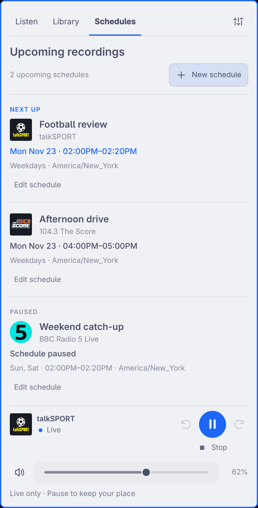](docs/yakker-schedules.png) | [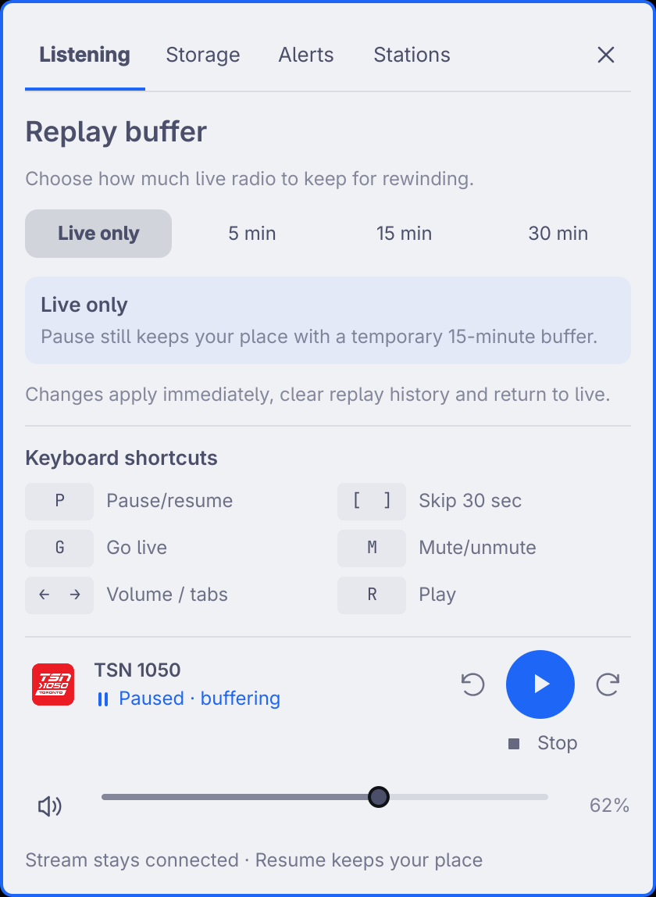](docs/yakker-settings.png) |

Yakker follows your active Omarchy colors, with Adwaita Sans for player text and local vector controls. Screenshots use Catppuccin Latte and varied stations; recording artwork follows the saved show’s source.

_Select any screenshot to enlarge it. Screens show the current native UI with
illustrative playback and recording data; see [how to refresh them](docs/screenshots.md)._

## What’s new in 1.6

The **Focus interface** puts listening first, with a compact tab row, favorite
presets, proportional typography, and a clear **Record · Stop · Sleep** row.

- **Playback stays within reach.** Library, Schedules, and Settings keep a
  persistent player with the same Pause/Stop hierarchy as Listen.
- **A clearer library and schedule flow.** Listening progress, timed Resume
  actions, grouped recording details, upcoming order, and next-recording previews
  make saved shows and schedules easier to manage.
- **Settings has four focused tabs.** Listening, Storage, Alerts, and Stations
  share a compact header. Storage has its own Save/Reset controls; notification
  switches apply immediately.
- **Consistent controls at smaller sizes.** Search, dropdowns, sliders, hover,
  focus, and keyboard navigation share one treatment. Controls reflow when needed,
  focused fields scroll into view, and Settings restores your browsing position.
- **A quieter bar with clearer status.** Smaller station artwork and state icons
  keep it compact; the tooltip explains playback, buffering, and active captures.
  New widgets start in `centerEnd`; existing widgets keep their position.

See the [1.6.0 release notes](docs/releases/1.6.0.md) for upgrade details and
validation coverage.

## Stations

| Country | City | Station | CLI station ID |
| --- | --- | --- | --- |
| US | Atlanta | 92.9 The Game | `wzgc-fm` |
| US | Boston | 98.5 The Sports Hub | `wbz-fm` |
| US | Boston | WEEI 93.7 | `weei-fm` |
| US | Chicago | 104.3 The Score | `wscr` |
| US | Cleveland | 92.3 The Fan | `wkrk-fm` |
| US | Columbus | 97.1 The Fan | `wbns-fm` |
| US | Dallas–Fort Worth | 105.3 The Fan | `krld-fm` |
| US | Denver | 104.3 The Fan | `kkfn-fm` |
| US | Detroit | 97.1 The Ticket | `wxyt-fm` |
| US | Los Angeles | AM 570 LA Sports | `klac` |
| US | Minneapolis | KFAN 100.3 | `kfan` |
| US | New York | ESPN New York 880 | `espn-new-york` |
| US | New York | WFAN 101.9 / 660 | `wfan` |
| US | Philadelphia | SportsRadio 94WIP | `wip-fm` |
| US | Pittsburgh | 93.7 The Fan | `kdka-fm` |
| US | San Diego | 97.3 The Fan | `kwfn-fm` |
| US | Seattle | Seattle Sports 710 | `kiro-am` |
| Canada | Montreal | TSN 690 | `tsn-690` |
| Canada | Toronto | Sportsnet 590 The FAN | `sportsnet-590` |
| Canada | Toronto | TSN 1050 | `tsn-1050` |
| UK | London | BBC Radio 5 Live | `bbc-radio-5-live` |
| UK | London | talkSPORT | `talksport` |
| UK | London | talkSPORT 2 | `talksport-2` |
| Ireland | Dublin | Off The Ball | `off-the-ball` |

## Requirements

- Omarchy / Quattro with `qs.Ui` controls and the documented bar-widget API (tested on Omarchy 4.5.0).
- Quickshell 0.3.2, Qt 6.12, and mpv 0.41 (tested versions).
- Go 1.26+ and Make to build from source. Go is only needed at build time.
- Linux with working audio. The bar widget also needs a desktop session with a private `XDG_RUNTIME_DIR`.
- Optional: the distribution's `mpv-mpris` package for media keys.
- Recordings need `ffmpeg` with the `libopus` encoder and `ffprobe`.
  Listening and playing retained recordings use mpv.

These are tested versions; older shells must provide the same native UI components.
The controller uses only Go’s standard library and builds without cgo. The
terminal tool includes Bubble Tea and Lip Gloss, with versions and checksums
pinned in `go.mod` and `go.sum`; the first build downloads those Go modules.
Both executables are standalone Linux binaries. The terminal modes need mpv and
audio; they can run without Omarchy or Qt.

## Install locally

For a compiled archive, extract it and run `./yakker tui` or
`./yakker install` from its `yakker/` directory; no build is needed.

For a source checkout:

```sh
git clone https://github.com/joega/yakker.git
cd yakker
make build
./yakker install
```

The build produces `yakker-controller` (the runtime controller) and `yakker`
(standalone playback and local installation). Run the installer from this checkout. It validates and copies the compiled controller, QML, and assets to
`~/.config/omarchy/plugins/io.github.joega.yakker`, rescans the existing shell,
and enables a new widget in `centerEnd`, beside the center island. Existing
widgets keep their saved section, order, and preferences. The manifest's
`barWidget.defaultSection` sets the default for new widgets; dragging a widget saves its section and order in
`~/.config/omarchy/shell.json`. It uses Omarchy's documented drop-in workflow; `omarchy dev link` is
for developing the shell itself. No second Quickshell instance is launched.
Run the installer again after editing this checkout. For helper/controller code
updates, stop playback and run `omarchy restart shell` after reinstalling so the
shared singleton and helper process load the new code. It refuses to overwrite
unmanaged installations or edits made directly in the installed files. Replaced
managed installations are retained under `~/.config/omarchy/plugin-backups/`.

Before upgrading, back up `~/.local/share/yakker/recordings.json` (or
`$XDG_DATA_HOME/yakker/recordings.json` when configured) while recordings are
idle. This build reads older indexes and preserves existing schedule timing.
Once padded schedules or new recordings are saved, the index contains fields
that v1.6.0 cannot read. Keep the index backup with the previous plugin for a
rollback; plugin backups contain code, not recording metadata. Recordings added
after that backup will not appear in a restored older index.

The source checkout must be built before installation; `omarchy plugin add`
clones source without compiling the controller. Update a local installation by
rebuilding and rerunning the installer from the same checkout path. The installer
keeps an ownership marker and refuses to overwrite files edited in the installed
copy. Existing bar entries and their saved preferences are retained.

`make build` produces stripped binaries. To create compiled Linux archives with
checksums and dependency license notices:

```sh
make release TARGET_ARCH=amd64
make release TARGET_ARCH=arm64
```

Archives are written to `dist/`. Each contains a `yakker/` directory with both
executables, the station catalogue, QML, local artwork, and this guide. Keep these
files together; the executables locate the catalogue beside themselves. Release
packaging builds locally and does not publish or install anything.

## Listen

Click the radio icon in the bar, select a station, then press the **Play** icon.
Your last chosen station is restored on later launches. If it is no longer in
the catalogue, choose another station; Yakker never substitutes a broadcaster.
The Focus player keeps the station title on one line above **Change station**.
Titles that overflow scroll slowly to the end and back, pausing at both ends.
Short titles stay still; reduced-motion mode uses an ellipsis and a full-title
tooltip instead. Preset and playback dock titles also stay on one line, without
independent animations; playback status can wrap to keep paused/stopped states
readable. The player includes up to six favorite presets in the order you added them. The **Listen**, **Library**,
and **Schedules** tabs form the first row, with Settings at the right edge. Both
navigation rows use the same label alignment, hover/focus treatment, and compact
spacing on narrow panels. Smaller artwork leaves room for station labels; replay
presets use two rows and saved-playback options stack when space is tight. Short
popups keep transport and volume visible while omitting the secondary playback
hint from the dock. Keyboard focus scrolls fields and actions into view.
Search fields, editors, and dropdowns share proportional
text, stable focus/hover insets, and a common minimum height. Library search and
status filters stack vertically on narrow panels; station dropdowns keep keyboard
search, selection, cancellation, and focus return. **Rewind · Play/Pause · Forward** form the
main transport row, with a larger Play/Pause control; **Record**, **Stop**, and
**Sleep** sit below it, with Stop centered beneath Play/Pause. Rewind and forward
skip 30 seconds and dim when unavailable. **Play/Pause** pauses or resumes
an active player; **Stop** releases it. Playing a stopped radio starts a fresh
live stream. Paused live radio is labeled **Paused · buffering**, with a pause
indicator and a reminder that the stream stays connected. Fully stopped radio
is labeled **Listening stopped**, with **Stream disconnected · Replay cleared**;
its replay track is hidden until listening starts again. These states also appear
in the persistent controls on Library, Schedules, and Settings. Saved recordings
use **Recording paused** or **Recording stopped**, and stopped recordings can be
resumed from Library. Closing the popup leaves audio playing.
Right-click the bar icon to open the station list directly.
The popup includes a text-style searchable station selector, volume, mute, connection status, and Retry after errors. Compact underline tabs and proportional typography keep the station name and transport controls prominent.
Search by station, city or country—for example, `690`, `Seattle`, `UK` or
`Ireland`; multiple words narrow the results together. Results show station
artwork, name, location and the selected station. **All / Favorites** filters
make saved stations easy to find. Use each row's heart to save or remove a
favorite without tuning in or closing the picker. Rows stay in place while you
change hearts, and favorites sort first on the next opening. Down/Up browses,
Enter selects, F toggles the highlighted favorite, and Escape closes.
Changing stations while playing makes a fresh live connection; while stopped it
selects the next station without starting playback. The last station, volume,
mute setting and listening buffer length are remembered across shell restarts.
The bar uses the standard icon canvas for smaller station artwork, retained
while playing or paused. Compact state icons indicate playing, paused, stopped,
behind-live, connecting/reconnecting, and offline states. Full status text and
connection/replay details stay in the tooltip. Stop restores the neutral radio
icon. A separate **REC** count shows background recordings even when listening
is stopped. Vertical bars use a compact state marker over the artwork and a
separate recording dot. The tooltip groups the source name and location, playback
state, replay availability and delay, and active recording names. Saved-show
playback identifies its original station and elapsed time. Long metadata is
bounded and displayed as plain text.

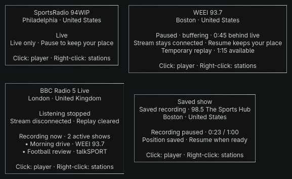

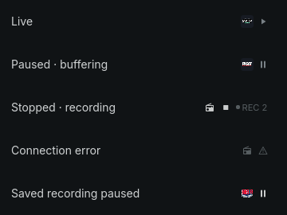

_Captions explain these examples; the bar itself uses state icons and a separate REC count._

Keyboard inside the popup: Tab/Shift+Tab or Up/Down moves between controls, including
Settings and the DVR controls when available;
Space/Enter activates the selection. Inside the station selector, type to search,
Down browses the matches, Enter selects, and Escape cancels and clears the search. Left/Right adjusts volume by 5%; M toggles
mute; R retries a stopped stream; Escape dismisses the popup. Right-clicking the
volume slider also toggles mute. Wheel over a slider uses the same steps as
Left/Right: 5% for volume or 30 seconds for playback position. When a slider is
focused, Page Up/Down adjusts volume by 10% or playback by one minute; Home/End
jumps to its limits. Sliders share a 36 px interaction height, inset tracks, and
hover/focus feedback without changing size. Recording elapsed and total times
sit at opposite ends of the track; the elapsed time previews a drag before seeking.

Left/Right on a navigation tab switches sections and keeps focus on the tab strip.
Closing Settings restores the previous view and scroll position, with focus on
its gear button. Manual scrolling takes over until the next focus move.
Tab continues through the controls in visual order. Fields use normal text-editing
keys, and Tab can leave the custom station editor for the persistent playback
controls. Mouse hover clears when the pointer leaves; keyboard focus remains
visible until you move it.

For diagnostics or scripted controls:

```sh
omarchy-shell shell summon io.github.joega.yakker '{}'
omarchy-shell io.github.joega.yakker play
omarchy-shell io.github.joega.yakker stop
omarchy-shell io.github.joega.yakker setVolume 65
omarchy-shell io.github.joega.yakker toggleMute
omarchy-shell io.github.joega.yakker setStation wfan
omarchy-shell io.github.joega.yakker chooseStation
omarchy-shell io.github.joega.yakker status
omarchy-shell shell hide io.github.joega.yakker
```

The Sleep menu shows the active countdown, quick duration choices, and a custom
minute field with a clear **Set timer** action. **Cancel timer** removes an active
timer without stopping listening. Recording captures continue when the timer ends.

[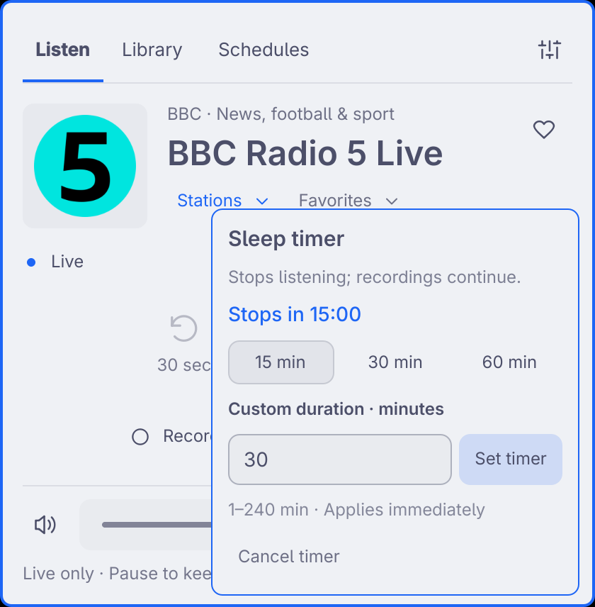](docs/yakker-sleep-timer.png)

## Pause and rewind

The **Sleep** button below Play/Pause opens the session-only **Sleep timer**: choose 15, 30, or 60
minutes, or set a custom duration from 1 to 240 minutes. It stops foreground
listening when it expires; captures continue. Changing stations keeps the
deadline, and pressing **Stop** cancels the timer.

The optional DVR-style buffer lets you pause a live station and listen from that
point later. Open **Settings → Listening** and choose a **Replay buffer** preset:

- **Live only** (default): no replay history is exposed until you pause.
- **5 minutes**, **15 minutes**, or **30 minutes**: enable pause and rewind for the selected station.

Press **Pause** or **P** during Live only playback to start a temporary **15-minute**
RAM buffer without reconnecting the stream. **Resume** continues from the paused
position, and the timeline, **Rewind / Forward**, and **Go live** become available.
The saved Live only setting stays unchanged. This temporary buffer ends when you
Stop, change stations, explicitly change the buffer setting, or close the player.
A stream reconnection retains temporary mode but clears the old connection's
audio, so the original paused position is lost.

With a configured buffer, use the same **Pause / Resume**, timeline,
**Rewind / Forward**, and **Go live** controls. Audio continues arriving while paused. History begins when buffering
is enabled; programmes from before that connection are unavailable. Changing
stations or buffer length, pressing Stop, or closing the player clears history.
The widget remembers the selected buffer length without starting playback at login.

Buffered audio stays in RAM; no audio files are recorded. The forward and backward
packet caches together are capped at 32 MiB for 5 minutes, 64 MiB for 15 minutes,
and 128 MiB for 30 minutes, in addition to normal player/decoder memory.
Temporary pause buffering uses the 15-minute / 64 MiB cap. To make immediate
pause possible without reconnecting, Live only also prepares this bounded
packet cache at startup. RAM use can therefore grow before you pause; earlier
audio is not exposed as replay history. This is a cap, not a fixed allocation. Actual use
grows with received audio. The byte cap can shorten the available window on
high-bitrate streams. When a paused position expires, playback moves to the oldest
available audio and remains paused. Reconnecting after a stream failure also clears
that connection's buffer. “Live” is relative to the newest audio received from the
station, which may already have a broadcaster delay.

Popup shortcuts: **P** pauses/resumes, **[ / ]** skip 30 seconds, and **G** goes live.
The plain CLI accepts `pause`, `play` (resume), `back 30`, `forward 30`, `live`, and
`buffer 0`, `buffer 5`, `buffer 15`, or `buffer 30`. Terminal modes use `--buffer`:

```sh
./yakker tui --buffer 30
./yakker listen --buffer 15
```

In the terminal UI, **P** pauses/resumes, **[ / ]** skip 30 seconds, **G** goes live,
and Space retains Play / Stop. Buffer preferences in terminal sessions are
independent of the desktop widget.

If a station cannot connect, a recovery card offers **Retry** and **Choose
station**, with technical information under **Show details**. Automatic retries
show the countdown; a compact Retry action also stays available in the playback
dock while browsing other sections.

[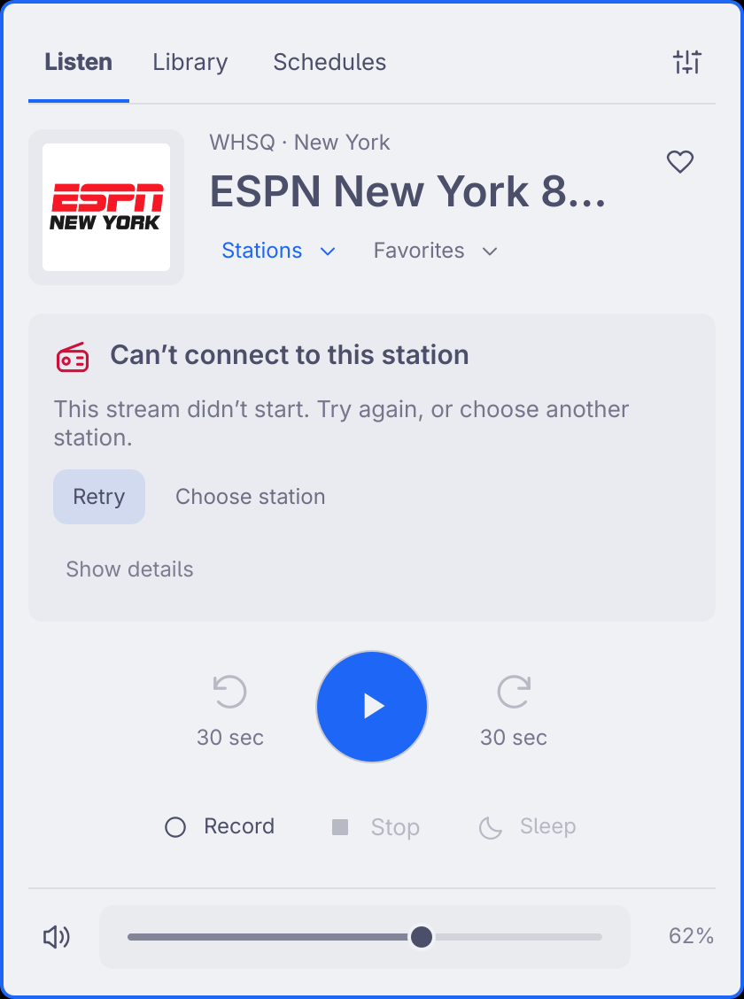](docs/yakker-connection-error.png)

## Scheduled recordings

Open **Library** or **Schedules** from the tabs at the top. Library also contains
**Record now** and **Storage**; **Record** on the player opens Record now directly.
In Schedules, choose **New schedule**, select a bundled or
custom station, then choose weekly weekdays or a one-time date. Enter start and
end times in 24-hour format. **Next recording** checks the resolved occurrence
automatically as you edit. The timezone defaults to your local zone; choose
**Change zone** when needed. For example, WEEI can record Fridays from `14:00`
to `14:20` in `America/New_York`. An end time before the
start ends the next day; recordings can last up to 12 hours. Daylight saving
follows the saved timezone. Schedules start empty; create and enable the ones
you want.

Use **Start early** and **End late** to add up to 10 minutes on either side of a
show. New schedules suggest 30 seconds early and 1 minute late; existing
schedules keep their saved timing with padding off until you edit it. The review
and upcoming list show the resulting **Captures** window, including seconds.
Padding follows the resolved timezone/DST occurrence and can cross midnight.
It counts toward the same storage and simultaneous-recording limits, so allow
for overlaps between adjacent shows. Changes apply to future captures; an active
recording and any linked remainder keep their original capture window.

Schedules appear in upcoming order, with **Next up** highlighted and paused
schedules grouped at the bottom. **Edit schedule** opens the saved values;
use the enabled switch to pause a schedule or the confirmed delete action to
remove it. Existing recordings stay in Library.

| Schedule editor | Record now |
| --- | --- |
| [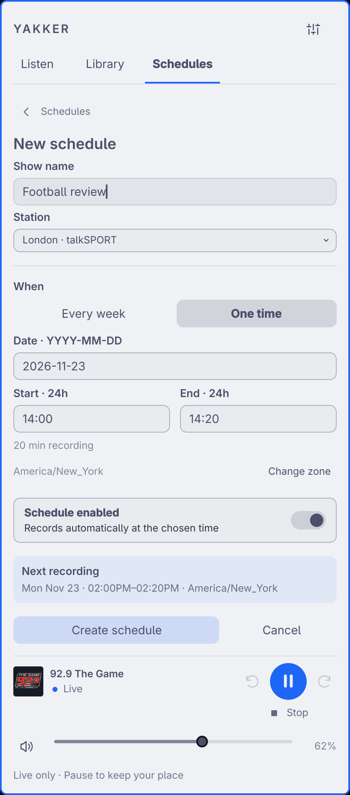](docs/yakker-schedule.png) | [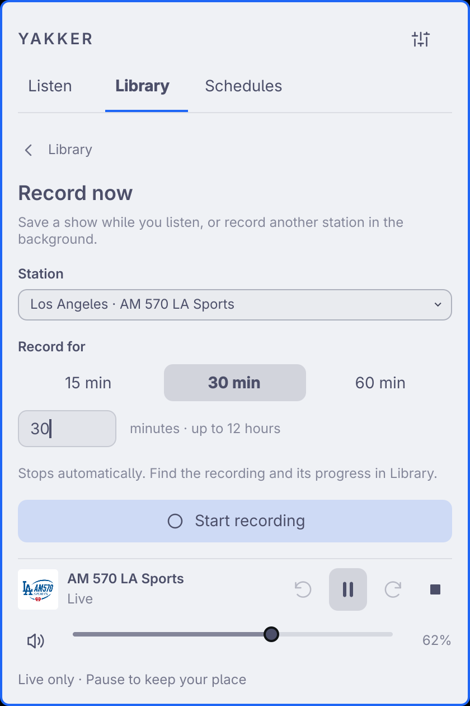](docs/yakker-record-now.png) |

For an immediate capture, choose **Record now**, a station, and a duration. It
defaults to 30 minutes, with 15, 30, and 60 minute presets and a custom range of
1 to 720 minutes. It uses the same storage and concurrency limits as scheduled
captures and does not create a repeating schedule.

| Saved-show playback | Recording storage |
| :---: | :---: |
| [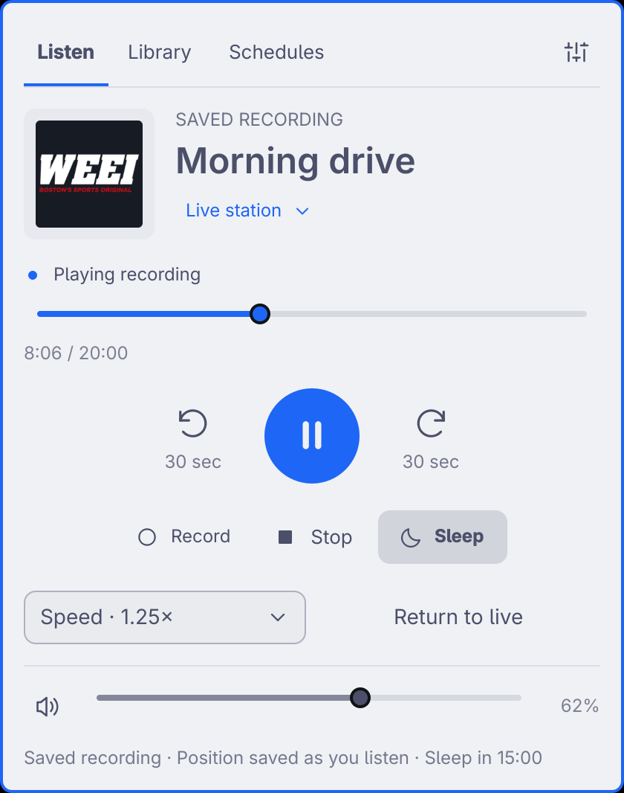](docs/yakker-recording-player.png) | [](docs/yakker-storage.png) |

Up to **three recordings** can run at once, including while you listen to another
station. Closing the popup, stopping foreground audio, changing stations, or
playing a saved recording leaves those captures running. The bar’s separate **REC** count marks active captures; a recording dot on the **Library** tab marks active captures.
The Library tooltip shows the count, and the persistent player in Settings
keeps a **REC** count that opens the library. The machine must be awake
with the plugin loaded in the bar. Disabling/removing the last widget, restarting
the shell, or shutting down the helper interrupts captures. Recoverable output is
retained as partial; when the plugin returns during the scheduled interval it can
capture a linked remainder. Unexpected stream failures can retry twice within
the remaining interval, retaining separate segments. There is no wake timer or separate recording service.
After a forced controller exit, the previous segment's exact end time may be
unavailable; recovery keeps a saved end time when present and does not substitute
the restart time. Retained audio and the original padded capture window remain
available for recovery.

Recordings use **mono Opus at 24 kbit/s VBR** in `.opus` files: roughly **3.6 MB
per 20 minutes** or **10.8 MB per hour**, plus container overhead, with sizes
varying by content. The bitrate is an internal encoder parameter; raising it later
affects future captures. The Library shows station artwork, show titles and
compact dates in each row. Partly listened-to saved shows display a progress bar, elapsed
and remaining audio time, and a **Resume** action labeled with the saved position.
The current show updates live and its row can pause/resume the same player.
Unknown durations never show an invented percentage. **Details**, restart,
deletion and storage controls use quieter secondary actions. Search
by title or station and filter by status across the full library before moving between pages. Open
**Details** for a compact status, duration, and size summary, separate scheduled
and recorded time ranges in local time, and any recording note. **Play from start**
and **Delete** are quiet secondary actions. Delete shows what will be removed and
requires confirmation; Cancel or Hide details clears that confirmation.

[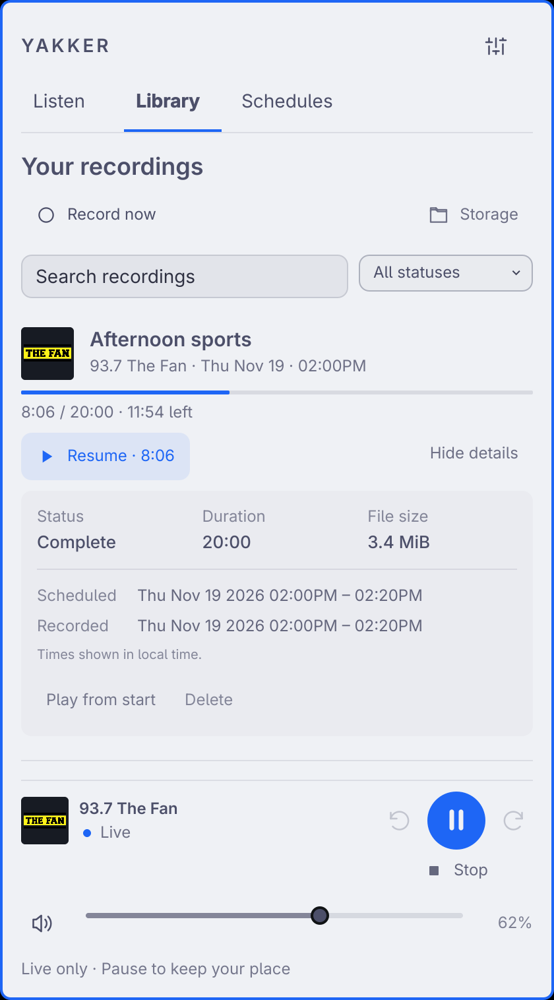](docs/yakker-recording-details.png)

**Play** or **Resume** starts a retained file while keeping the library open.
An empty library explains how to **Record now** or create a **New schedule**.
When a search or status filter matches nothing, **Clear filters** resets both
without changing saved audio. Library loading failures are shown separately from
an empty library. Station search offers a clear-search or Show all stations action
when no results or favorites are available.

| Empty library | No matching recordings |
| --- | --- |
| [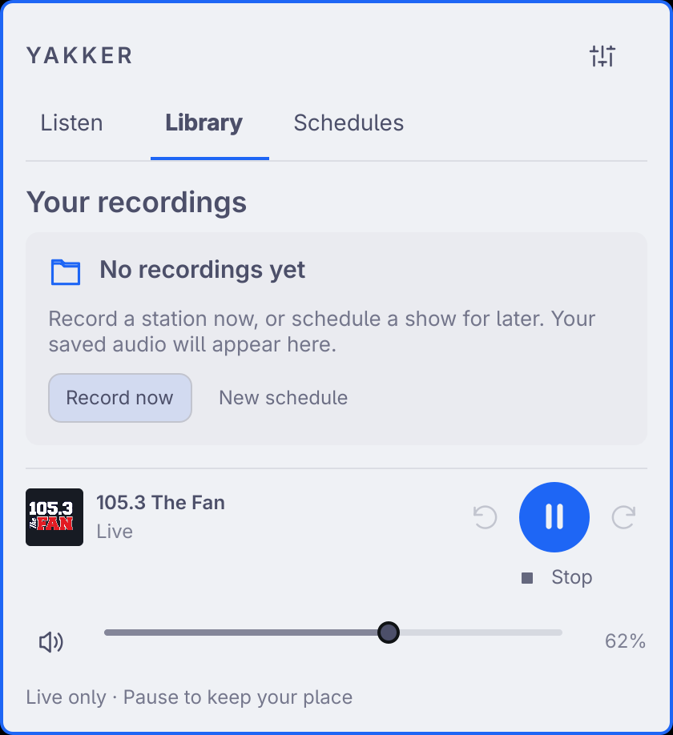](docs/yakker-empty-library.png) | [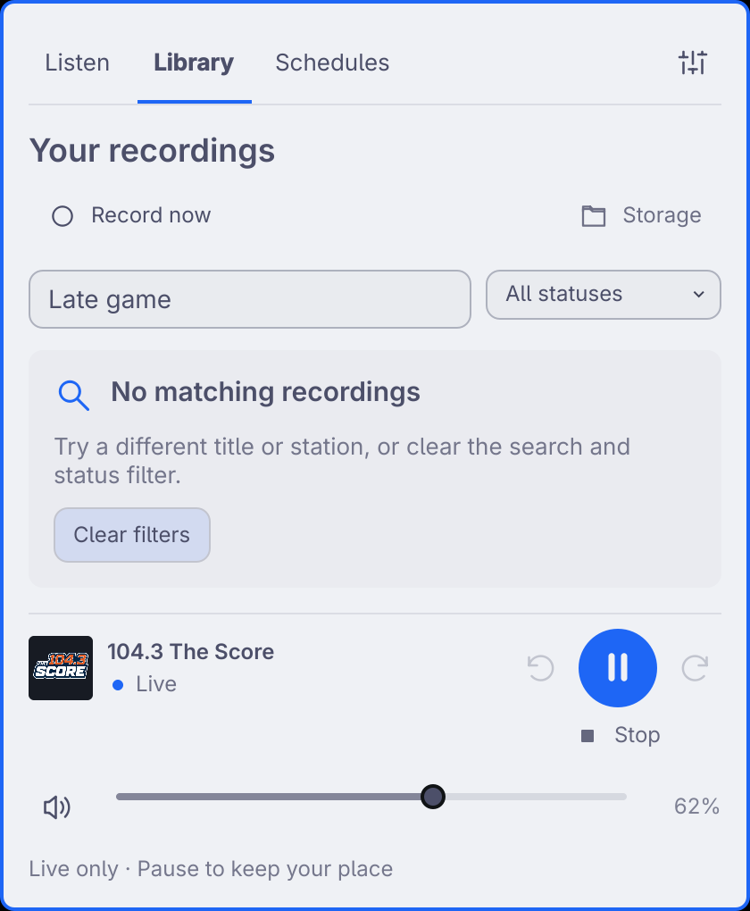](docs/yakker-empty-search.png) |

A fixed playback dock remains available while you scroll recordings, schedules,
editors, or settings. It uses the same round Pause/Resume control as Listen, with
a smaller labeled Stop directly beneath it, quieter 30-second skips, and volume.
The playing row also offers Pause/Resume. Choose **Listen** for the full player, duration-based
seek bar, speed controls, and **Return to live**. Artwork follows the source of
the saved show, independently of the selected live station. Position is saved
at most every 10 seconds and when pausing, stopping, switching, or shutting down;
finishing or reaching the end resets it. Saved recordings support 0.75×, 1×,
1.25×, 1.5×, and 2× playback with pitch correction; live listening returns to
1×. Missing files become available again when their retained folder returns.
Schedules follow the computer clock. The scheduler checks once per second;
connection setup adds further delay before audio arrives. Exact broadcast
boundaries depend on the source: buffered feeds and HLS segments can contain
audio from before the connection, so a file's audio duration can exceed the
scheduled interval. **Duration** measures retained audio; the **Recorded** range
tracks the stream-reader process, excluding the writer's drain and later file inspection.
Details also show the intended **Capture window** when padding is enabled,
separately from the show's scheduled interval and the recorded process times.
Neither guarantees the broadcaster's program-clock boundaries. Early cutoffs
are retained as partial recordings. The stream reader and Opus writer use a
bounded in-memory pipe, so the writer can finish received audio even if an HLS
reader stalls. A forced reader stop still leaves a partial-recording note;
a writer failure warns that ending audio may be missing. Audio quality
depends on the source and the recording codec.

Dates use a consistent format such as **Fri Nov 20 2026 02:30PM**. Library dates
use local time; upcoming schedule times and previews use the schedule's timezone.

Open **Settings → Storage**, or the storage controls in Library, to
choose a folder and total library cap. Enter a path or use **Choose folder**;
**Open folder** opens it in your file manager. A usage bar shows the saved library
limit; **Save storage** applies folder and limit edits and confirms the save
on the same tab. **Reset** discards unsaved storage edits. Folder actions remain quiet secondary controls. Defaults:

- **Folder:** `~/Music/Yakker`, created when the first capture needs it.
- **Library cap:** 5 GiB, editable in Settings.
- **Free-space reserve:** 1 GiB on the destination disk.
- **Cleanup:** manual deletion; existing recordings are preserved when full.

Recording notifications are on by default for completed, partial, failed, and
missed captures and storage or manager failures. The **Alerts** tab
uses switches for **Recording alerts** and **When recording starts**, which is
off by default. Notification changes apply immediately. Turning alerts off
disables the start switch without erasing its saved preference. Yakker suppresses
duplicate notices and does not announce old recordings again at startup.

A folder change applies to future recordings. Older files remain listed at their
saved locations and count toward the cap. An unavailable/unwritable destination
produces an explicit failure instead of switching folders. Lowering the cap below
current usage preserves files and blocks new captures until space is available.
Metadata, schedules and recording settings live separately in
`$XDG_DATA_HOME/yakker/recordings.json` (normally
`~/.local/share/yakker/recordings.json`), outside the replaceable plugin files.
Uninstalling the plugin preserves this data and the audio files.

Schedule edits and enable/disable/delete actions affect future occurrences; an
already running capture retains its original settings and has a separate **Stop
capture** action. Editing a station does not silently change a saved schedule's
source. Saving that schedule in the editor refreshes its source from the latest
available catalogue entry; a removed station's saved source is retained. Saved
recordings survive schedule deletion. Delete requires confirmation, and a capture
or file that is currently playing must be stopped before deletion.

Changes from another monitor or a background job can make an editor stale. Your
draft stays visible; **Refresh and keep this draft** lets you review and resubmit
it. The helper can restart with bounded retries after an interruption, restoring
schedules without automatically starting foreground listening. Terminal sessions
remain independent and do not start the desktop scheduler.

## Terminal player

Open the Bubble Tea player without changing the installed widget:

```sh
./yakker tui
```

Run `./yakker tui` to choose a station on first launch, then press Enter to play.
Later terminal sessions restore your last chosen station.
An explicit `--station` overrides that choice. Terminal selection is saved
separately from the desktop widget in `$XDG_CONFIG_HOME/yakker/terminal.json`
(normally `~/.config/yakker/terminal.json`). Sessions using `--stations` or `--url`
keep their selections separate and do not change that saved choice.

The player shows the current station, actual playback/connection status, volume,
mute, and stream metadata when available. It uses a compact layout in smaller
terminals and adapts its colors to the terminal background and color support.

| Key | Action |
| --- | --- |
| Space | Play / Stop |
| `p` | Pause / Resume; starts a temporary buffer in Live only |
| `[` / `]` | Rewind / forward 30 seconds |
| `g` | Go live |
| Left / Right or `-` / `+` | Change volume by 5% |
| `m` | Toggle mute |
| Up / Down or `k` / `j` | Browse configured stations |
| Enter | Tune the highlighted station |
| `r` | Make a fresh connection |
| `?` | Show / hide help |
| `q`, Escape, or Ctrl+C | Quit and clean up playback |

Browsing leaves playback on the current station until Enter. The active station
is marked with a dot; the highlighted row is the station selected for tuning.
Play after Stop reconnects to the live stream. The interface returns the terminal
to its normal screen and waits for player cleanup when you quit.

The same `--url`, `--stations`, `--volume`, `--muted`, and `--list-stations`
arguments work with `tui`; use `./yakker tui --help` for details. It needs an
interactive terminal. The plain `listen` command below remains available for
line-oriented or piped input. Both modes keep the desktop audio environment and
widget settings intact and use their own temporary lock/socket directory.

## Standalone CLI

The built CLI runs independently of the installed Omarchy widget:

```sh
./yakker listen --station wbz-fm --volume 60
```

It starts the selected station and prints readable connection/playback status.
Without `--station`, `listen` uses your last terminal station. If none has been
chosen, or it was removed, use `--list-stations` and supply a station ID.
Volume defaults to 60%; `--muted` starts muted. Its private lock/socket directory
is created and removed automatically. Desktop audio environment variables,
widget settings, and the installed plugin are not changed.

Type a command and press Enter:

```text
volume 40
mute
unmute
stop
play
status
help
quit
```

`mute` toggles mute; `unmute` always unmutes. `play` after `stop` connects to a
fresh live stream. Ctrl+C or input EOF also exits and cleans up the player.
Invalid commands show a readable message without interrupting playback.

To discover station IDs, test an arbitrary stream, or use another station file:

```sh
./yakker listen --list-stations
./yakker listen --url 'https://example.com/live.aac' --volume 60
./yakker listen --stations /path/to/stations.json --station my-station
./yakker listen --help
```

The example URL is a placeholder; supply an actual HTTP(S) audio stream. A custom
URL uses a temporary station record and does not modify `stations.json`.
Arguments are parsed locally; the widget's JSON protocol stays internal.
This is a plain line-oriented CLI; each command requires Enter.

## Settings and stations

The gear opens **Settings**, starting with four tabs: **Listening**, **Storage**,
**Alerts**, and **Stations**. Listening shows the Live only / 5 / 15 / 30 minute
buffer choices directly, with an explanation of the selected mode and a compact
two-column keyboard shortcut reference. Each tab replaces the content below it;
the playback dock stays available, with the X at the right end of the tab row.
X returns to your previous player section.
Storage has its own Save and Reset controls. Alerts apply immediately and have
no save buttons. Switching tabs preserves unfinished storage and station drafts;
closing settings discards unsaved drafts.

In **Stations**, choose **Add station** and enter a name and direct HTTP(S) audio
stream URL. City, country, and website are optional, with persistent labels above
each field. Saved custom stations appear here with a quiet **Edit station**
action, so you can edit any custom station without changing your listening
selection. Delete lives in the editor and requires confirmation. Escape or Cancel
returns from the editor to the station list; Escape from a settings tab closes
settings. Deleting the selected station stops playback and clears its selection.
Editing its stream URL reconnects if it was playing. Yakker does not fetch or
test a URL until you play it.

| Notification settings | Custom station editor |
| --- | --- |
| [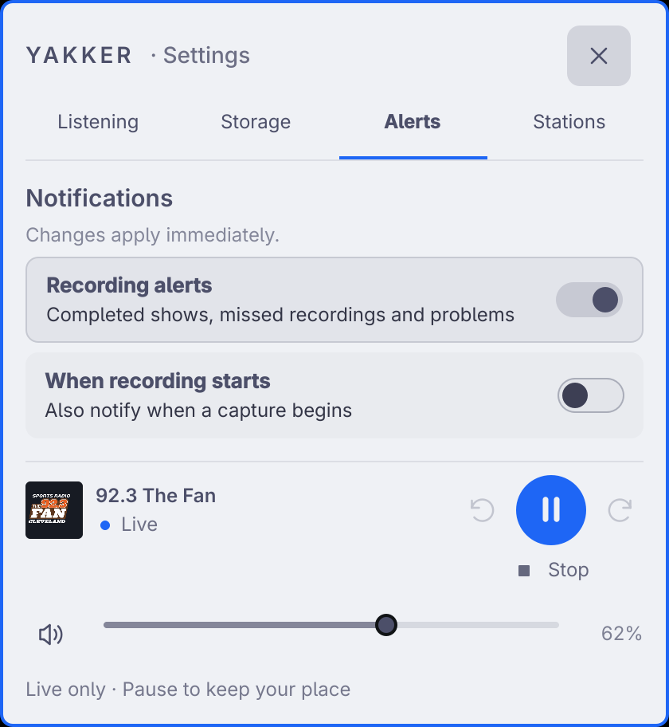](docs/yakker-notifications.png) | [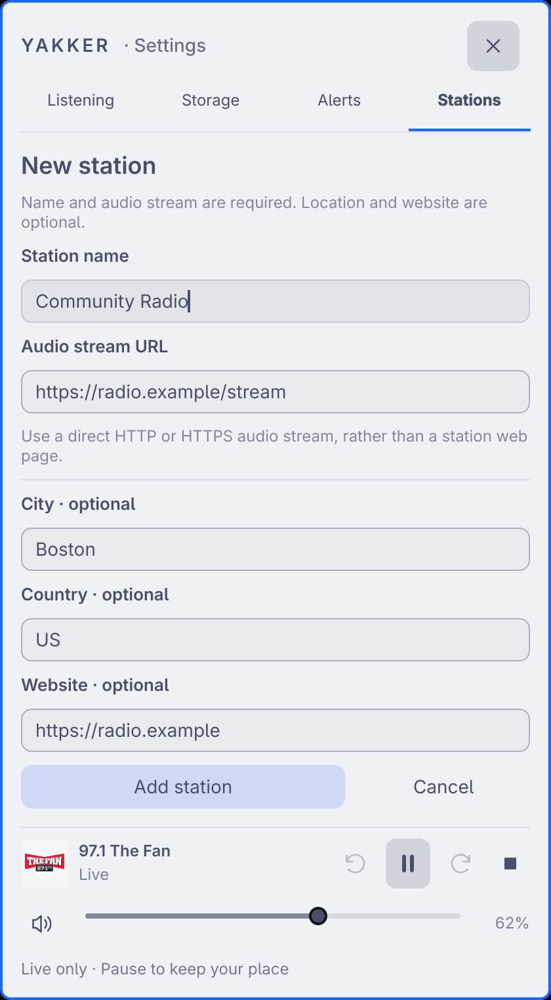](docs/yakker-custom-station.png) |

Custom stations are saved separately from the installed plugin in `$XDG_CONFIG_HOME/yakker/stations.json` (normally `~/.config/yakker/stations.json`). They persist through plugin upgrades and removal. The default terminal player and `--list-stations` include them; explicit `--stations` and `--url` sessions remain isolated. If the custom file cannot be read or is malformed, the widget keeps bundled stations available and shows an error; repair the file and restart Yakker before editing. The terminal player reports the error.

Use the heart beside the station title to add or remove the selected station from favorites. The first six favorites appear as presets on Listen; all favorites appear first in the station picker and in matching search results, including custom stations. Selecting a preset follows the same rules as the picker: it changes the stream while listening and selects without starting playback while stopped.

The selected station, favorites, volume, mute and listening buffer length are saved through Quattro's inline entry persistence in
`~/.config/omarchy/shell.json`. The widget entry also accepts:

```json
{
  "id": "io.github.joega.yakker",
  "volume": 65,
  "muted": false,
  "stationId": "",
  "favorites": [],
  "bufferMinutes": 0,
  "recordingNotifications": true,
  "recordingStartNotifications": false,
  "showName": false,
  "recordingNotifications": true,
  "recordingStartNotifications": false,
  "mprisPlugin": ""
}
```

Choose a station by ID from the [catalogue above](#stations).

For example: `./yakker tui --station tsn-690 --volume 60` or
`./yakker tui --station talksport --volume 60`.
The UK selection includes football talk on talkSPORT, broader live sport on
talkSPORT 2, and news/football/sport on BBC Radio 5 Live. Off The Ball adds Irish
football and sports discussion. The BBC entry uses its worldwide feed.
The standalone terminal modes keep their session independent of saved widget settings.

`showName` adds a compact “Radio” label on horizontal bars. `stations.json`
contains station ID, name, subtitle, HTTP(S) stream URL, optional city/country/website,
optional local `artwork` path, optional `artworkBackground` color for logo contrast,
and an optional fallback Nerd Font `icon`. Both the bar and terminal player read
this catalogue. After editing station data, rebuild/reinstall and restart the shell.
New artwork must also be included in the installer and release file lists; tests
check the bundled catalogue's coverage. No network configuration fetch is needed.

## Media keys and metadata

Stock mpv does not provide MPRIS. To opt in with an existing, trusted
[mpv-mpris](https://github.com/hoyon/mpv-mpris) installation, set `mprisPlugin`
to its absolute file path (a common Arch path is `/etc/mpv/scripts/mpris.so`).
No plugin or global keybinding is installed automatically. All other mpv user
configuration and scripts are disabled for predictable playback.

MPRIS exists while the player is running and exposes the station title, state,
volume, and media controls. Pause retains buffered audio; in Live only mode it starts the same temporary
15-minute buffer as the widget and terminal controls. After Stop, use the radio widget to start again: no idle MPRIS player is
kept alive. Your desktop chooses which application's MPRIS session media keys
control. Native widget controls work with MPRIS disabled.

The helper observes stream metadata and shows an actual `icy-title` or `title`
when supplied. The verified WBZ response identifies the station and AAC stream;
a changing current-program title is not guaranteed. There is no scraped program
schedule, fabricated show name, remote artwork fetch, or periodic website request. The official station logo is bundled locally.

## Lifecycle and reliability

A shared QML singleton owns one compiled Go helper. The helper owns one foreground
mpv process and a JSON IPC socket under `$XDG_RUNTIME_DIR/io.github.joega.yakker/`.
A private runtime directory and exclusive lock prevent duplicate players, including
across monitors or overlapping shell reloads. Stop cancels retry work, terminates
mpv, waits for it, and removes the socket before another player can start.

Popup closing and bar visibility do not own playback. Recreating widgets has a
one-second grace period. With no widgets left (disable/remove), the helper shuts
down. EOF, SIGTERM, and Linux parent-death protection clean up the player if the
shell or helper exits. Recording workers have independent foreground controls
and are finalized/reaped on helper shutdown. Full shell restarts may stop
listening; press Play to reconnect.
Playback intent is never saved or automatically restored after login.

Failed connections and stalled streams time out and retry at 1, 2, 4, 8, and 16
seconds, then stop with Retry available. A minute of successful playback resets
the failure budget. Network buffering is reported as Connecting. State comes
from mpv events rather than an optimistic Play button. Live only starts playback as audio arrives and prepares a bounded in-memory
packet cache for immediate pause; end-to-end delay also depends on the
broadcaster, output device, and network.

## Disable and remove

```sh
omarchy plugin disable io.github.joega.yakker
omarchy plugin remove io.github.joega.yakker --yes
```

Disable removes the bar entry and shuts down radio within a few seconds. Remove
also deletes the installed copy. Capture finalization may take a few more seconds.
Recording files, schedules and this source checkout remain available.

## Troubleshooting

- Missing mpv: install your distribution's `mpv` package, then Retry.
- Unable to connect: check network access and the station stream; Retry after the
  bounded attempts finish. Regional restrictions or broadcaster outages can apply.
- Helper already owned: allow the old shell a moment to exit, then Retry. Do not
  delete the live owner's lock file; the lock is released by process exit.
- No sound with “Live”: check radio volume/mute, the system output and mixer.
  “Live” confirms player activity, not acoustic output from your speakers.
- Missing widget: run `omarchy plugin list --json`, then `omarchy plugin enable
  io.github.joega.yakker`. Inspect logs with `qs log -n -p "$OMARCHY_PATH/shell"
  --tail 100`.
- Recording encoder unavailable: install your distribution's FFmpeg package with
  libopus and ffprobe, then disable/re-enable the widget or restart the shell.
- Recording index unavailable: preserve and repair the reported metadata file;
  Yakker refuses to overwrite malformed data. Ordinary listening remains available.
- Source edits: rerun the local installer. Do not modify packaged Omarchy files.

## Build checks

```sh
make check
YAKKER_TEST_REAL_MPV=1 make check  # Also decode local test audio with mpv
```

Checks cover formatting, vet, module checksums, and race-enabled tests. The
recording checks include atomic storage/recovery, timezone/DST rules, cap limits,
revision fencing and child cleanup. The optional mpv checks use local HTTP
fixtures and null audio; they do not contact
broadcasters or change the installed widget. GitHub Actions runs these checks
and builds Linux amd64 and arm64 archives.

For an isolated investigation of audio duration and scheduled boundaries, see
the [recording timing audit](tools/recording-audit/README.md). It compares decoded
audio with time-coded local fixtures and can optionally sample selected stations.
The [matched-source quality comparison](tools/recording-quality/README.md)
prepares randomized 24/48 kbit/s samples from local reference audio for listening
checks, with full-rate decode measurements. It does not change the recording bitrate.
For a live acceptance run across several stations, the
[scheduled recording audit](tools/scheduled-recordings-audit.md) checks real padded
schedules, decoded head/tail audio, silent playback and persisted resume using
isolated data. It requires explicit station selection and contacts those broadcasters.
The [recovery audit](tools/recording-recovery-audit.md) uses a controlled loopback
source to test disconnects, stalls, controller loss, bounded retries and linked
remainders without changing the installed library or connecting to broadcasters.

Optional native UI checks (installed Omarchy controls required):

```sh
python3 tools/test-recordings-ui.py
python3 tools/test-recordings-ui.py --compact --output /tmp/yakker-compact-ui-qa
```

This uses isolated temporary settings/data and silent local audio. It verifies
keyboard navigation, scheduling, preview, stale drafts, file playback/seek and
helper recovery, and writes screenshots under `/tmp/yakker-recordings-ui-qa`.
The compact audit includes native card padding, 68 view/size/font combinations,
Tab traversal and focus visibility, manual scrolling and Settings return, and
station, filter and timer popover bounds and cancellation.
Its test container substitutes for the actual layer-shell popup. Audible quality,
physical sleep/resume, and installed-shell focus/lifecycle behavior also need
manual checks on the target desktop.

## Privacy and licensing

Yakker has no analytics, account system, or background station discovery.
Playback connects to the selected broadcaster and its stream providers, which
receive the network request. Enabled recording schedules also connect to their
saved station sources while due and the plugin is running. Artwork and station configuration are bundled
locally. The widget saves station, volume, and mute preferences on your device;
standalone terminal sessions use temporary local state.

The code is MIT licensed; see [LICENSE](LICENSE). Station artwork and broadcaster
marks are owned by their respective owners and are excluded from the code
license; see [artwork attribution](assets/README.md). Compiled archives include
`THIRD_PARTY_NOTICES.txt` for their Go dependencies.

## Made something with Yakker?

If you build something with Yakker, please consider crediting
[Yakker](https://github.com/joega/yakker) by [@joega](https://github.com/joega)
in your README or credits. I'd love to see what you make—share a link in an issue!

This is an optional request; use of Yakker is governed by the MIT license above.
